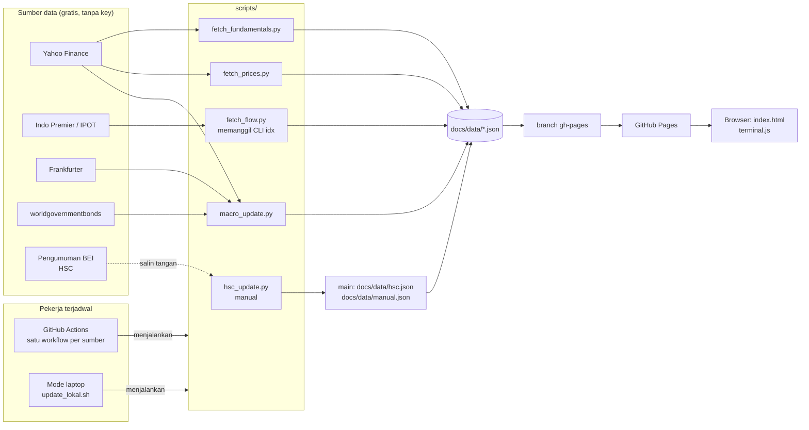

# Arsitektur IDX Lite

IDX Lite adalah terminal saham Indonesia yang **statis**: tidak ada server dan tidak ada database. Pekerja terjadwal mengambil data, menyimpannya sebagai file JSON, lalu GitHub Pages menyajikan file itu bersama satu halaman web yang menghitung dan menampilkan semuanya di browser.

Prinsipnya:

1. **Ambil data terpisah dari menyajikan.** Kalau sumber data gagal, situs tetap tayang dengan data terakhir.
2. **Setiap sumber gagal sendiri-sendiri.** Satu langkah gagal tidak menghentikan langkah lain (`continue-on-error` di workflow, `step` di mode laptop).
3. **Data hasil olahan tidak masuk riwayat git `main`.** Data hanya hidup di branch `gh-pages`, yang ditimpa sebagai satu commit setiap kali terbit.
4. **Gratis.** Repo publik, GitHub Actions, GitHub Pages, sumber data tanpa API key.

## Gambaran besar



## Komponen

| Bagian | File | Tugas |
| --- | --- | --- |
| Inti tampilan | `docs/core.js` | Memuat data, format angka, indikator teknikal, filter, dan semua "perintah" yang menghasilkan isi halaman |
| Tampilan utama | `docs/index.html`, `docs/app.js`, `docs/app.css` | Menu, pencarian saham, halaman saham bertab, formulir screener; memanggil perintah dari `core.js` |
| Mode terminal | `docs/terminal.html`, `docs/terminal.js`, `docs/terminal.css` | Baris perintah untuk pengguna mahir; `terminal.css` juga dipakai tampilan utama |
| Papan tabel | `docs/board.html` | Tampilan lama: tabel semua saham, screener, watchlist |
| Makro | `scripts/macro_update.py` | USD/IDR, IHSG, WTI, yield SBN 2Y/5Y/10Y (AsianBondsOnline), CDS manual → `data.json`, `macro_series.json`, `macro_hist.json` |
| Harga | `scripts/fetch_prices.py` | Candle harian 1 tahun semua saham di `symbols.txt` → `prices/`, `summary.json` |
| Fundamental | `scripts/fetch_fundamentals.py` | Valuasi, laporan kuartalan dan tahunan, 100 saham per run (bergilir) → `fundamentals/`, `fundamentals.json` |
| Foreign & broker | `scripts/fetch_flow.py` | Memanggil CLI [`idx`](https://github.com/fzn0x/idx) → `flow/` |
| Kepemilikan | `scripts/fetch_ownership.py` | Register KSEI pemegang > 1% lewat `idx ownership sync` (mirror GitHub) → `ownership/` |
| Brief | `scripts/fetch_brief.py` | `idx stocks brief` per saham, 100 saham per run bergilir → `brief/`, `brief_index.json` |
| Pembantu | `scripts/idxcli.py` | Menjalankan `idx -o json` dan menyimpan JSON, dipakai skrip kepemilikan dan brief |
| HSC | `scripts/hsc_update.py` | Memperbarui daftar Kepemilikan Saham Terkonsentrasi Tinggi → `hsc.json` |
| Isian manual | `docs/data/manual.json` | Cadangan CDS/yield kalau scraper gagal |
| Workflow | `.github/workflows/*.yml` | Satu workflow per sumber data, plus `site.yml` untuk kode tampilan |
| Langkah bersama | `.github/actions/{setup,restore,publish}` | Menyiapkan Python/idx, mengambil data tayang, menerbitkan sebagian `gh-pages` |
| Mode laptop | `scripts/update_lokal.sh` | Pengganti workflow, dijalankan dari WSL |

## Workflow dan jadwal (WIB, Senin–Jumat)

Setiap sumber data punya workflow sendiri. Kalau satu sumber error atau lambat, hanya workflow itu yang gagal; yang lain tetap terbit, dan yang gagal bisa dijalankan ulang sendiri tanpa mengulang semuanya.

| Workflow | File | Jadwal | Isi yang diterbitkan |
| --- | --- | --- | --- |
| situs | `situs` → `site.yml` | setiap push ke `main` | HTML/JS/CSS, `hsc.json`, `manual.json` |
| makro | `makro.yml` | 08, 10, 12, 14, 16, 19 | `data.json` |
| harga | `harga.yml` | 16:30, diulang 19:30 | `summary.json`, `prices/` |
| fundamental | `fundamental.yml` | 16:45 | `fundamentals.json`, `fundamentals/` |
| kepemilikan | `kepemilikan.yml` | 17:00 | `ownership/` |
| brief | `brief.yml` | 17:15 | `brief/`, `brief_index.json` |
| foreign-broker | `flow.yml` | 19:30 | `flow/` |
| sinyal | `sinyal.yml` | setiap kali harga/fundamental selesai sukses; cadangan 17:40 dan 20:15 | `signals.json` |
| laporan-ai | `ai.yml` | 12:10 Sen–Kam, 11:40 Jum (sesi 1); 17:05 (penutupan) | `ai/` + pesan Telegram |

Menjalankan ulang satu bagian: `gh workflow run harga.yml` (atau tombol *Run workflow* di tab Actions). Menjalankan semuanya: `./scripts/jalankan_semua.sh`.

Foreign & broker bisa dimatikan sementara tanpa mengubah kode: `gh variable set SKIP_FLOW --body 1`, dan dinyalakan lagi dengan `gh variable delete SKIP_FLOW`. Run manual tetap jalan walau sakelar ini aktif.

Jadwal GitHub bisa terlambat beberapa menit sampai sekitar satu jam dan sesekali dilewati; karena itu harga diambil dua kali. Jadwal repo publik yang tidak ada aktivitas sekitar 60 hari bisa dinonaktifkan GitHub; aktifkan lagi dengan `gh workflow enable <nama>`.

## Alur satu workflow

Semua workflow data memakai tiga langkah bersama di `.github/actions/`:

1. **setup**: Python dan `requirements.txt`; untuk kepemilikan, brief dan foreign-broker juga CLI `idx` beserta cache respons dan database kepemilikannya.
2. **restore**: menyalin bagian `gh-pages` yang dibutuhkan ke `docs/` (misalnya data lama yang dilanjutkan), tanpa menimpa file dari `main`.
3. **publish**: mengganti **hanya** path milik workflow itu di `gh-pages`, bagian lain dibiarkan. Branch tetap satu commit. Kalau dua workflow menerbitkan bersamaan, push memakai `--force-with-lease`; yang kalah cepat mengulang dari isi terbaru (sampai enam kali), jadi tidak ada hasil yang tertimpa.

Kalau skrip gagal total, publish tidak dijalankan dan situs tetap menampilkan data lama. Skrip yang bisa lama (fundamental, brief, foreign-broker) dibungkus `timeout`, dan `fetch_flow.py` punya batas waktu total (`--budget`, 35 menit) serta pemutus: setelah 5 kegagalan berturut-turut di satu bagian (misalnya Indo Premier sedang error), sisa bagian itu dilewati. Yang sudah berhasil tetap diterbitkan.

## Data di `docs/data/`

| File | Isi | Dibuat oleh |
| --- | --- | --- |
| `summary.json` | Satu baris per saham: harga, perubahan, volume, nilai, SMA20/50, RSI14 | fetch_prices |
| `prices/KODE.json` | `[tanggal, open, high, low, close, volume]` per hari, 1 tahun | fetch_prices |
| `fundamentals.json` | Ringkasan valuasi per saham + kapan diambil | fetch_fundamentals |
| `fundamentals/KODE.json` | Laporan kuartalan (≤ 8) dan tahunan (≤ 4) dengan QoQ/YoY | fetch_fundamentals |
| `data.json` | Indikator makro + perubahan (yield dalam bp: 1 hari, 1 minggu, YTD) + status tiap sumber | macro_update |
| `macro_series.json` | Riwayat harian 1 tahun IHSG, USD/IDR, WTI (Yahoo) | macro_update |
| `macro_hist.json` | Arsip harian sendiri semua indikator makro (untuk tren yield & CDS), maks 3 tahun | macro_update |
| `flow/bandar_1d.json`, `bandar_1w.json` | Bandarmology 100 saham teraktif (`idx.bandar.screen.v1`) | fetch_flow |
| `flow/market_foreign.json` | Net asing per saham: rupiah dari IPOT (`idx.market.foreign.value.v1`), atau lembar dari idx.co.id (`idx.market.foreign.v1`) bila `idx` versi rilis belum punya `--source ipot` | fetch_flow |
| `flow/market_brokers.json` | Ranking broker seluruh pasar (`idx.market.brokers.v1`) | fetch_flow |
| `flow/broker/KODE.json` | Broker summary sesi terakhir (`idx.broker.v1`) | fetch_flow |
| `flow/foreign/KODE.json` | Riwayat foreign harian 20 sesi (`idx.foreign.value.v1`) | fetch_flow |
| `flow/foreign_hist.json` | Arsip harian net asing, bertambah tiap hari (maks 120 sesi) | fetch_flow |
| `flow/meta.json` | Waktu dan status tiap langkah foreign/broker | fetch_flow |
| `ownership/meta.json` | Tanggal register, pembanding, ringkasan perubahan seluruh pasar | fetch_ownership |
| `ownership/index.json` | Per saham: jumlah pemegang > 1%, total %, porsi asing, pemegang terbesar | fetch_ownership |
| `ownership/t/KODE.json` | Daftar pemegang dan perubahannya sejak register sebelumnya | fetch_ownership |
| `brief/KODE.json` | Isi `idx stocks brief` (`idx.brief.v1`) | fetch_brief |
| `brief_index.json` | Kapan brief tiap saham terakhir diambil | fetch_brief |
| `signals.json` | Skor & status time to buy (teknikal, fundamental, gabungan) per saham likuid, urutan daftar, aturan, tanggal sinyal pertama muncul | build_signals |
| `ai/index.json` | Daftar laporan (maks 120) | ai_report |
| `ai/<tanggal>-sesi1.json`, `ai/<tanggal>-full.json` | Angka laporan, teks AI, model, status kirim Telegram | ai_report |
| `ai/latest.json` | Laporan terbaru (dipakai halaman Pasar) | ai_report |
| `ai/stocks.json` | Catatan AI untuk sekitar 10 saham teraktif/penggerak (laporan penutupan) | ai_report |
| `manual.json` | Isian manual CDS/yield | manusia |
| `hsc.json` | Daftar HSC + tanggal publikasi + sumber | hsc_update / manusia |

File `flow/` adalah amplop JSON `idx` apa adanya (`schema`, `provider`, `fetched_at`, `warnings`, `data`). Arti tiap field ada di [docs/json-output.md](https://github.com/fzn0x/idx/blob/main/docs/json-output.md) milik `idx`.

## Terminal web

Ada dua wajah di atas satu inti. `core.js` berisi semua perintah (`quote`, `broker`, `foreign`, `screen`, …). `app.js` memetakan menu, tab dan tombol ke perintah itu lewat alamat `#/s/KODE/tab` atau `#/halaman?c=perintah`, sedangkan `terminal.js` menjalankannya dari baris perintah. Tidak ada framework dan tidak perlu build.

- **Data** dimuat sesuai kebutuhan lewat `getJSON()` dan disimpan di memori selama halaman terbuka.
- **Perintah** didaftarkan dengan `def(nama, contoh, deskripsi, fungsi, alias)`. Fungsi menerima argumen hasil `parseArgs()` dan mengembalikan HTML, atau mengisi panel sendiri bila perlu grafik.
- **Filter** (`screen`, `bandar screen`) memakai satu mesin, `compileFilter()`, dengan peta kunci masing-masing (`SKEYS`, `BKEYS`).
- **Indikator teknikal** (SMA, EMA, RSI Wilder, MACD, Bollinger, ATR) dihitung di browser dari `prices/KODE.json`.
- **HSC**: `hsc.json` dimuat saat halaman dibuka. Kode HSC diberi lencana merah di semua tabel, dan perintah satu saham (`quote`, `technical`, `fundamental`, `broker`, `foreign`, `bandar`) menampilkan catatan merah di atas panel.
- **URL** `?cmd=...` menjalankan perintah saat halaman dibuka, jadi hasil bisa dibagikan sebagai tautan.

Menambah perintah (otomatis bisa dipakai di terminal; untuk tampil di menu atau tab, tambahkan juga di `PAGES`/`TABS` di `app.js`):

```js
def("contoh", "contoh BBCA", "Penjelasan singkat untuk help.", async (a, body) => {
  const sym = symArg(a);            // kode saham dari argumen pertama
  const s = await stock(sym);       // baris summary.json
  return `<p>${esc(sym)} ${nf(s.price)}</p>`;
});
```

## Ketahanan dan plan B

| Kalau ini gagal | Yang terjadi | Plan B |
| --- | --- | --- |
| Yahoo Finance | Harga/fundamental tidak diperbarui, data lama tetap tayang | Ganti `fetch_prices.py` agar memanggil `idx -o json stocks history` (`--provider auto` mencoba Yahoo lalu MSN) |
| Indo Premier | `flow/` tidak diperbarui | Jalankan mode laptop; dari koneksi rumahan `idx` juga bisa membaca idx.co.id |
| worldgovernmentbonds | CDS/yield `n/a` | Isi `manual.json` |
| GitHub Actions dibatasi | Tidak ada update otomatis | Mode laptop dengan Task Scheduler, atau self-hosted runner |
| GitHub Pages | Situs tidak tayang | Terbitkan isi `gh-pages` ke Cloudflare Pages atau Netlify (cek ketentuan paket gratisnya) |

### Mode laptop

`scripts/update_lokal.sh` melakukan hal yang sama dengan workflow dari WSL: mengambil data tayang dari `gh-pages`, menjalankan skrip, lalu force-push ke `gh-pages`.

Persiapan sekali:

```bash
cd ~/idx-lite && source venv/bin/activate && pip install -r requirements.txt
curl -fsSL https://raw.githubusercontent.com/fzn0x/idx/main/install.sh | sh   # CLI idx
gh auth setup-git                                                           # agar git push memakai login gh
./scripts/update_lokal.sh all                                               # uji sekali
```

Menjadwalkan tiap jam lewat Windows Task Scheduler (WSL berhenti sendiri saat tidak ada terminal terbuka, jadi cron di dalam WSL kurang andal). Jalankan di PowerShell:

```powershell
schtasks /Create /TN "idx-lite update" /SC HOURLY /ST 08:05 /TR "wsl.exe -d Ubuntu -- bash -lc '~/idx-lite/scripts/update_lokal.sh >> ~/idx-lite/update.log 2>&1'"
```

Mode `auto` menjalankan makro setiap kali, harga dan fundamental sekali sehari setelah 16:15 WIB, serta foreign dan broker sekali sehari setelah 19:00 WIB. Penanda harian disimpan di `~/.local/state/idx-lite/`. Laptop harus menyala; kalau sempat tidur, langkah yang terlewat dijalankan pada jam berikutnya.

Kalau mode laptop menjadi jalur utama, matikan workflow data dengan `gh workflow disable <nama>`, supaya dua pekerja tidak saling menimpa. Keduanya selalu mulai dari isi `gh-pages` terbaru, jadi menjalankan keduanya sesekali tetap aman.

## HSC (Kepemilikan Saham Terkonsentrasi Tinggi)

BEI menerbitkan daftar HSC lewat pengumuman di idx.co.id (menu *Kepemilikan Saham Terkonsentrasi Tinggi*), tanpa jadwal tetap. idx.co.id memblokir server GitHub, jadi daftar ini **diperbarui manual**:

```bash
sudo apt install -y poppler-utils                                   # sekali, untuk pdftotext
python scripts/hsc_update.py --pdf "/mnt/c/Users/<nama>/Downloads/pengumuman-hsc.pdf"
git add docs/data/hsc.json && git commit -m "hsc: pengumuman 2026-11-11" && git push
```

Dari lampiran PDF, skrip membaca nomor pengumuman, tanggal pengumuman, tanggal evaluasi, tanggal efektif di IHSG (hari bursa ke-2 setelah pengumuman), persentase kepemilikan 10 pemegang terbesar, status baru/lanjutan, dan tanda catatan (`*`, `**`, `***`) tiap saham. Tanpa PDF, daftar kode bisa ditempel lewat stdin, atau diubah sebagian dengan `--add` / `--remove`.

Push ke `main` langsung menerbitkan ulang situs. Skrip mencetak saham yang masuk dan keluar dibanding daftar sebelumnya, jadi hasilnya bisa dicek sebelum push. Hitungan hari bursa efektif tidak memperhitungkan hari libur bursa; cocokkan dengan teks pengumuman.

## Pengatur jadwal, alarm, dan uji

Jadwal `schedule` GitHub bersifat *best effort*: pada repo kita banyak jadwal yang tidak pernah terpicu. Karena itu:

- **`pengatur`** (`scripts/pengatur.py`) jalan setiap ±20 menit (jadwal GitHub di menit 07/27/47, ditambah pemicu luar cron-job.org lewat `workflow_dispatch`). Ia melihat jam WIB, riwayat run hari ini, dan data di `gh-pages`, lalu memicu bagian yang sudah waktunya tetapi belum sukses hari ini. Aturannya: makro tiap ±2 jam (07:30–21:30); laporan sesi 1 12:10–13:25 (Jumat 11:40–13:55); harga mulai 16:25, diulang tiap 60 menit (maks 4×) selama sesi hari ini belum tayang; fundamental 16:45, kepemilikan 17:00, brief 17:15 (sekali sehari, maks 2 percobaan); sinyal kalau tertinggal dari harga; laporan penutupan setelah harga hari ini tayang (paling lambat 18:30); foreign-broker 19:30. Yang sedang jalan atau sudah terlalu sering dicoba dilewati, jadi aman dipicu berkali-kali. Jadwal lama di tiap workflow tetap ada sebagai cadangan; laporan AI tidak dikirim dua kali untuk hari dan jenis yang sama.
- **`alarm`** mengirim pesan Telegram setiap workflow data selesai dengan status gagal, lengkap dengan tautan log.
- **`uji`** jalan setiap push: cek sintaks Python/JS/YAML lalu menjalankan `build_signals.py` dan `pengatur.py --dry-run` dengan data yang sedang tayang (hasil tidak diterbitkan). Kalau merah, alarm berbunyi sebelum jadwal sore memakai kode yang rusak.

## Time to buy (watchlist sinyal beli)

`scripts/build_signals.py` menilai setiap saham likuid (rata-rata nilai 20 hari ≥ Rp1 M, harga ≥ Rp50; saham HSC yang likuid ikut dinilai dengan peringatan) dari tiga sudut pandang, masing-masing skor 0–100:

- **Teknikal** dari `prices/`: tren (SMA20/50/200), momentum (RSI, MACD), setup masuk (breakout 20 hari bervolume, pullback ke MA20 di tren naik, rebound dari oversold, MACD cross, golden cross), volume; penalti overbought dan harga terlalu jauh dari MA20. Stop = yang lebih dekat antara 2× ATR14 dan low 10 hari; target = resistance 60 hari atau 2× risiko.
- **Fundamental** dari `fundamentals.json`: ROE, pertumbuhan pendapatan/laba YoY, P/E dibanding median sektor (Yahoo `sector`, minimal 5 saham; selain itu median pasar), P/B, PEG, target dan rekomendasi analis, dividen. Saham rugi dikeluarkan.
- **Gabungan**: rata-rata keduanya, dengan syarat keduanya ≥ 50 dan harga di atas SMA50.

Fundamental dan brief diambil bergilir 100 saham per hari. Untuk mengisi semuanya sekaligus, jalankan workflow `fundamental` atau `brief` dengan `isi_semua=true`: skrip hanya mengambil saham yang belum lengkap, berhenti rapi setelah 36 menit (hasil disimpan berkala), lalu memicu putaran berikutnya sendiri sampai tidak ada yang tersisa. Rantai berhenti sendiri kalau satu putaran tidak berhasil mengambil apa pun (mis. dibatasi Yahoo).

Status *Sinyal beli* atau *Pantau* mengikuti ambang di `RULES` pada skrip (aturan yang sama ditampilkan di situs, bagian *Cara penilaian*). Tanggal pertama sebuah sinyal beli muncul disimpan (`since`), jadi hasilnya sejak itu bisa dipantau. Workflow `sinyal` dipicu otomatis oleh selesainya `harga` atau `fundamental` (`workflow_run`), sehingga tidak perlu menebak jam.

Tampil di menu **Time to Buy** (tab Gabungan, Teknikal, Fundamental, Watchlist saya), kartu *Time to buy* di tab Ringkasan saham, perintah terminal `buy`, dan bagian *Time to buy* di laporan Telegram penutupan. *Watchlist saya* (tombol ☆ di halaman saham) disimpan di browser masing-masing, tidak di server.

## Laporan AI dan Telegram

`scripts/ai_report.py sesi1|full` dijalankan workflow `laporan-ai`:

1. Cek hari bursa: tanggal candle IHSG (Yahoo, interval 5 menit) harus hari ini; kalau tidak, berhenti tanpa laporan. Laporan sesi 1 juga dilewati kalau jadwal GitHub telat sampai sesi 2 sudah buka.
2. Skrip menghitung semua angka sendiri: IHSG dan rentangnya, naik/turun dari 150 (sesi 1) atau 300 (penutupan) saham teraktif menurut `summary.json`, top gainer/loser (nilai ≥ 0,5 M / 1 M, tanpa saham HSC), teraktif, saham HSC yang bergerak ≥ 10%, USD/IDR, WTI, yield SBN, dan net asing kalau `flow/market_foreign.json` sudah sesi hari ini.
3. Angka itu dikirim ke LLM lewat endpoint *OpenAI-compatible* (`AI_BASE_URL`, `AI_MODEL`, `AI_API_KEY`). Prompt melarang menambah fakta, menebak penyebab, dan memberi rekomendasi beli/jual. Laporan penutupan juga meminta catatan singkat per saham dalam satu panggilan.
4. Pesan Telegram (HTML, ≤ 4096 karakter) dikirim ke setiap id di `TELEGRAM_CHAT_ID`; kalau HTML ditolak, dikirim ulang sebagai teks biasa.
5. Hasil disimpan di `ai/` dan diterbitkan ke situs: kartu di halaman Pasar, menu **Laporan AI** (dengan arsip), dan *Catatan AI* di tab Ringkasan saham.

Tanpa `AI_API_KEY` atau saat layanan AI gagal, laporan tetap dibuat dan dikirim tanpa paragraf AI. Tanpa token Telegram, laporan hanya tampil di situs. Penyedia bawaan Google Gemini (tier gratis Google AI Studio); bisa diganti Groq atau OpenRouter hanya dengan mengubah variabel `AI_BASE_URL` dan `AI_MODEL`. Batas gratis penyedia bisa berubah sewaktu-waktu. Key dan token hanya disimpan sebagai *repository secret*, tidak pernah di kode.

## Batasan

- Harga tertunda dan bersumber dari layanan tidak resmi; cocokkan dengan sumber resmi sebelum mengambil keputusan.
- Foreign dan broker hanya untuk 100 saham paling aktif, dalam rupiah, dari 10 broker teratas per sisi yang diterbitkan IPOT.
- Sinyal teknikal dan bandarmology adalah heuristik, bukan saran investasi.
- Time to buy adalah penyaring berbasis aturan sederhana dari data tertunda. Tidak ada backtest; pantau kolom *sejak* untuk melihat hasil nyatanya.
- Ringkasan AI ditulis model bahasa dari angka laporan; bisa salah tafsir. Angka di laporan dihitung skrip, bukan oleh AI.
- Tidak ada akun pengguna. Riwayat perintah dan watchlist disimpan di browser masing-masing.
