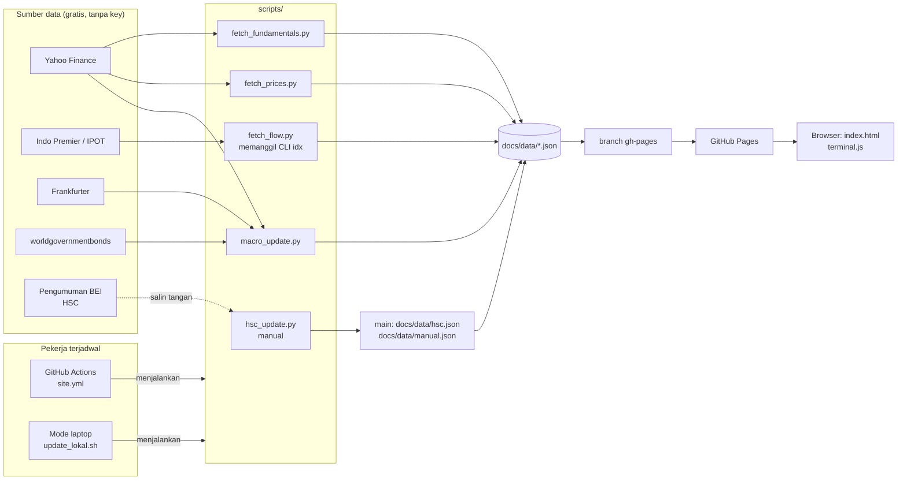

# Arsitektur IDX Lite

IDX Lite adalah terminal saham Indonesia yang **statis**: tidak ada server dan tidak ada database. Pekerja terjadwal mengambil data, menyimpannya sebagai file JSON, lalu GitHub Pages menyajikan file itu bersama satu halaman web yang menghitung dan menampilkan semuanya di browser.

Prinsipnya:

1. **Ambil data terpisah dari menyajikan.** Kalau sumber data gagal, situs tetap tayang dengan data terakhir.
2. **Setiap sumber gagal sendiri-sendiri.** Satu langkah gagal tidak menghentikan langkah lain (`continue-on-error` di workflow, `step` di mode laptop).
3. **Data hasil olahan tidak masuk riwayat git `main`.** Data hanya hidup di branch `gh-pages`, yang ditimpa sebagai satu commit setiap kali terbit.
4. **Gratis.** Repo publik, GitHub Actions, GitHub Pages, sumber data tanpa API key.

## Gambaran besar



## Komponen

| Bagian | File | Tugas |
| --- | --- | --- |
| Inti tampilan | `docs/core.js` | Memuat data, format angka, indikator teknikal, filter, dan semua "perintah" yang menghasilkan isi halaman |
| Tampilan utama | `docs/index.html`, `docs/app.js`, `docs/app.css` | Menu, pencarian saham, halaman saham bertab, formulir screener; memanggil perintah dari `core.js` |
| Mode terminal | `docs/terminal.html`, `docs/terminal.js`, `docs/terminal.css` | Baris perintah untuk pengguna mahir; `terminal.css` juga dipakai tampilan utama |
| Papan tabel | `docs/board.html` | Tampilan lama: tabel semua saham, screener, watchlist |
| Makro | `scripts/macro_update.py` | USD/IDR, IHSG, WTI, CDS, yield → `data.json` |
| Harga | `scripts/fetch_prices.py` | Candle harian 1 tahun semua saham di `symbols.txt` → `prices/`, `summary.json` |
| Fundamental | `scripts/fetch_fundamentals.py` | Valuasi, laporan kuartalan dan tahunan, 100 saham per run (bergilir) → `fundamentals/`, `fundamentals.json` |
| Foreign & broker | `scripts/fetch_flow.py` | Memanggil CLI [`idx`](https://github.com/fzn0x/idx) → `flow/` |
| Kepemilikan | `scripts/fetch_ownership.py` | Register KSEI pemegang > 1% lewat `idx ownership sync` (mirror GitHub) → `ownership/` |
| Brief | `scripts/fetch_brief.py` | `idx stocks brief` per saham, 100 saham per run bergilir → `brief/`, `brief_index.json` |
| Pembantu | `scripts/idxcli.py` | Menjalankan `idx -o json` dan menyimpan JSON, dipakai skrip kepemilikan dan brief |
| HSC | `scripts/hsc_update.py` | Memperbarui daftar Kepemilikan Saham Terkonsentrasi Tinggi → `hsc.json` |
| Isian manual | `docs/data/manual.json` | Cadangan CDS/yield kalau scraper gagal |
| Workflow | `.github/workflows/site.yml` | Jadwal, urutan langkah, terbit ke `gh-pages` |
| Mode laptop | `scripts/update_lokal.sh` | Pengganti workflow, dijalankan dari WSL |

## Jadwal (WIB, Senin–Jumat)

| Waktu | Langkah | Alasan |
| --- | --- | --- |
| 08:00, 10:00, 12:00, 14:00 | makro | Murah, berubah sepanjang hari |
| 16:30 | makro, harga, fundamental, kepemilikan, brief | Bursa tutup 16:15; candle harian sudah final. Kepemilikan hanya ditulis ulang saat register bulanan baru terbit |
| 19:30 | makro, harga (ulang), foreign & broker | IPOT baru menerbitkan broker summary setelah tutup, dan ranking broker serta statistik pasar baru bisa diberi tanggal setelah 19:00 |
| setiap push ke `main` | makro, terbit ulang | Perubahan tampilan langsung tayang |
| manual (`gh workflow run build-and-deploy`) | semua langkah | Mengisi data kapan saja |

Jadwal GitHub bisa terlambat beberapa menit sampai puluhan menit. Jadwal repo publik yang tidak ada aktivitas selama 60 hari dinonaktifkan GitHub; aktifkan lagi di tab Actions.

## Alur satu run

1. Checkout `main` (kode, `symbols.txt`, `manual.json`, `hsc.json`).
2. Clone `gh-pages` lalu salin `data/` ke `docs/data/` **tanpa menimpa** file dari `main`. Dengan begitu data lama ikut terbawa, dan file yang diedit manusia selalu menang.
3. Jalankan skrip sesuai jadwal. Skrip menimpa file yang berhasil diambil saja.
4. `docs/` di-commit sebagai satu commit baru dan di-force-push ke `gh-pages`. Riwayat `gh-pages` selalu satu commit, jadi repo tidak membengkak.
5. GitHub Pages menerbitkan ulang `gh-pages` dalam 1–2 menit.

Respons CLI `idx` disimpan di cache Actions (`.idx-cache`), sehingga riwayat foreign tidak diunduh ulang dari nol setiap hari.

## Data di `docs/data/`

| File | Isi | Dibuat oleh |
| --- | --- | --- |
| `summary.json` | Satu baris per saham: harga, perubahan, volume, nilai, SMA20/50, RSI14 | fetch_prices |
| `prices/KODE.json` | `[tanggal, open, high, low, close, volume]` per hari, 1 tahun | fetch_prices |
| `fundamentals.json` | Ringkasan valuasi per saham + kapan diambil | fetch_fundamentals |
| `fundamentals/KODE.json` | Laporan kuartalan (≤ 8) dan tahunan (≤ 4) dengan QoQ/YoY | fetch_fundamentals |
| `data.json` | Indikator makro + status tiap sumber | macro_update |
| `flow/bandar_1d.json`, `bandar_1w.json` | Bandarmology 100 saham teraktif (`idx.bandar.screen.v1`) | fetch_flow |
| `flow/market_foreign.json` | Net asing per saham: rupiah dari IPOT (`idx.market.foreign.value.v1`), atau lembar dari idx.co.id (`idx.market.foreign.v1`) bila `idx` versi rilis belum punya `--source ipot` | fetch_flow |
| `flow/market_brokers.json` | Ranking broker seluruh pasar (`idx.market.brokers.v1`) | fetch_flow |
| `flow/broker/KODE.json` | Broker summary sesi terakhir (`idx.broker.v1`) | fetch_flow |
| `flow/foreign/KODE.json` | Riwayat foreign harian 20 sesi (`idx.foreign.value.v1`) | fetch_flow |
| `flow/foreign_hist.json` | Arsip harian net asing, bertambah tiap hari (maks 120 sesi) | fetch_flow |
| `flow/meta.json` | Waktu dan status tiap langkah foreign/broker | fetch_flow |
| `ownership/meta.json` | Tanggal register, pembanding, ringkasan perubahan seluruh pasar | fetch_ownership |
| `ownership/index.json` | Per saham: jumlah pemegang > 1%, total %, porsi asing, pemegang terbesar | fetch_ownership |
| `ownership/t/KODE.json` | Daftar pemegang dan perubahannya sejak register sebelumnya | fetch_ownership |
| `brief/KODE.json` | Isi `idx stocks brief` (`idx.brief.v1`) | fetch_brief |
| `brief_index.json` | Kapan brief tiap saham terakhir diambil | fetch_brief |
| `manual.json` | Isian manual CDS/yield | manusia |
| `hsc.json` | Daftar HSC + tanggal publikasi + sumber | hsc_update / manusia |

File `flow/` adalah amplop JSON `idx` apa adanya (`schema`, `provider`, `fetched_at`, `warnings`, `data`). Arti tiap field ada di [docs/json-output.md](https://github.com/fzn0x/idx/blob/main/docs/json-output.md) milik `idx`.

## Terminal web

Ada dua wajah di atas satu inti. `core.js` berisi semua perintah (`quote`, `broker`, `foreign`, `screen`, …). `app.js` memetakan menu, tab dan tombol ke perintah itu lewat alamat `#/s/KODE/tab` atau `#/halaman?c=perintah`, sedangkan `terminal.js` menjalankannya dari baris perintah. Tidak ada framework dan tidak perlu build.

- **Data** dimuat sesuai kebutuhan lewat `getJSON()` dan disimpan di memori selama halaman terbuka.
- **Perintah** didaftarkan dengan `def(nama, contoh, deskripsi, fungsi, alias)`. Fungsi menerima argumen hasil `parseArgs()` dan mengembalikan HTML, atau mengisi panel sendiri bila perlu grafik.
- **Filter** (`screen`, `bandar screen`) memakai satu mesin, `compileFilter()`, dengan peta kunci masing-masing (`SKEYS`, `BKEYS`).
- **Indikator teknikal** (SMA, EMA, RSI Wilder, MACD, Bollinger, ATR) dihitung di browser dari `prices/KODE.json`.
- **HSC**: `hsc.json` dimuat saat halaman dibuka. Kode HSC diberi lencana merah di semua tabel, dan perintah satu saham (`quote`, `technical`, `fundamental`, `broker`, `foreign`, `bandar`) menampilkan catatan merah di atas panel.
- **URL** `?cmd=...` menjalankan perintah saat halaman dibuka, jadi hasil bisa dibagikan sebagai tautan.

Menambah perintah (otomatis bisa dipakai di terminal; untuk tampil di menu atau tab, tambahkan juga di `PAGES`/`TABS` di `app.js`):

```js
def("contoh", "contoh BBCA", "Penjelasan singkat untuk help.", async (a, body) => {
  const sym = symArg(a);            // kode saham dari argumen pertama
  const s = await stock(sym);       // baris summary.json
  return `<p>${esc(sym)} ${nf(s.price)}</p>`;
});
```

## Ketahanan dan plan B

| Kalau ini gagal | Yang terjadi | Plan B |
| --- | --- | --- |
| Yahoo Finance | Harga/fundamental tidak diperbarui, data lama tetap tayang | Ganti `fetch_prices.py` agar memanggil `idx -o json stocks history` (`--provider auto` mencoba Yahoo lalu MSN) |
| Indo Premier | `flow/` tidak diperbarui | Jalankan mode laptop; dari koneksi rumahan `idx` juga bisa membaca idx.co.id |
| worldgovernmentbonds | CDS/yield `n/a` | Isi `manual.json` |
| GitHub Actions dibatasi | Tidak ada update otomatis | Mode laptop dengan Task Scheduler, atau self-hosted runner |
| GitHub Pages | Situs tidak tayang | Terbitkan isi `gh-pages` ke Cloudflare Pages atau Netlify (cek ketentuan paket gratisnya) |

### Mode laptop

`scripts/update_lokal.sh` melakukan hal yang sama dengan workflow dari WSL: mengambil data tayang dari `gh-pages`, menjalankan skrip, lalu force-push ke `gh-pages`.

Persiapan sekali:

```bash
cd ~/idx-lite && source venv/bin/activate && pip install -r requirements.txt
curl -fsSL https://raw.githubusercontent.com/fzn0x/idx/main/install.sh | sh   # CLI idx
gh auth setup-git                                                           # agar git push memakai login gh
./scripts/update_lokal.sh all                                               # uji sekali
```

Menjadwalkan tiap jam lewat Windows Task Scheduler (WSL berhenti sendiri saat tidak ada terminal terbuka, jadi cron di dalam WSL kurang andal). Jalankan di PowerShell:

```powershell
schtasks /Create /TN "idx-lite update" /SC HOURLY /ST 08:05 /TR "wsl.exe -d Ubuntu -- bash -lc '~/idx-lite/scripts/update_lokal.sh >> ~/idx-lite/update.log 2>&1'"
```

Mode `auto` menjalankan makro setiap kali, harga dan fundamental sekali sehari setelah 16:15 WIB, serta foreign dan broker sekali sehari setelah 19:00 WIB. Penanda harian disimpan di `~/.local/state/idx-lite/`. Laptop harus menyala; kalau sempat tidur, langkah yang terlewat dijalankan pada jam berikutnya.

Kalau mode laptop menjadi jalur utama, matikan jadwal Actions dengan menghapus baris `schedule` di `site.yml`, supaya dua pekerja tidak saling menimpa. Keduanya selalu mulai dari isi `gh-pages` terbaru, jadi menjalankan keduanya sesekali tetap aman.

## HSC (Kepemilikan Saham Terkonsentrasi Tinggi)

BEI menerbitkan daftar HSC lewat pengumuman di idx.co.id (menu *Kepemilikan Saham Terkonsentrasi Tinggi*), tanpa jadwal tetap. idx.co.id memblokir server GitHub, jadi daftar ini **diperbarui manual**:

```bash
sudo apt install -y poppler-utils                                   # sekali, untuk pdftotext
python scripts/hsc_update.py --pdf "/mnt/c/Users/<nama>/Downloads/pengumuman-hsc.pdf"
git add docs/data/hsc.json && git commit -m "hsc: pengumuman 2026-11-11" && git push
```

Dari lampiran PDF, skrip membaca nomor pengumuman, tanggal pengumuman, tanggal evaluasi, tanggal efektif di IHSG (hari bursa ke-2 setelah pengumuman), persentase kepemilikan 10 pemegang terbesar, status baru/lanjutan, dan tanda catatan (`*`, `**`, `***`) tiap saham. Tanpa PDF, daftar kode bisa ditempel lewat stdin, atau diubah sebagian dengan `--add` / `--remove`.

Push ke `main` langsung menerbitkan ulang situs. Skrip mencetak saham yang masuk dan keluar dibanding daftar sebelumnya, jadi hasilnya bisa dicek sebelum push. Hitungan hari bursa efektif tidak memperhitungkan hari libur bursa; cocokkan dengan teks pengumuman.

## Batasan

- Harga tertunda dan bersumber dari layanan tidak resmi; cocokkan dengan sumber resmi sebelum mengambil keputusan.
- Foreign dan broker hanya untuk 100 saham paling aktif, dalam rupiah, dari 10 broker teratas per sisi yang diterbitkan IPOT.
- Sinyal teknikal dan bandarmology adalah heuristik, bukan saran investasi.
- Tidak ada akun pengguna. Riwayat perintah dan watchlist disimpan di browser masing-masing.
